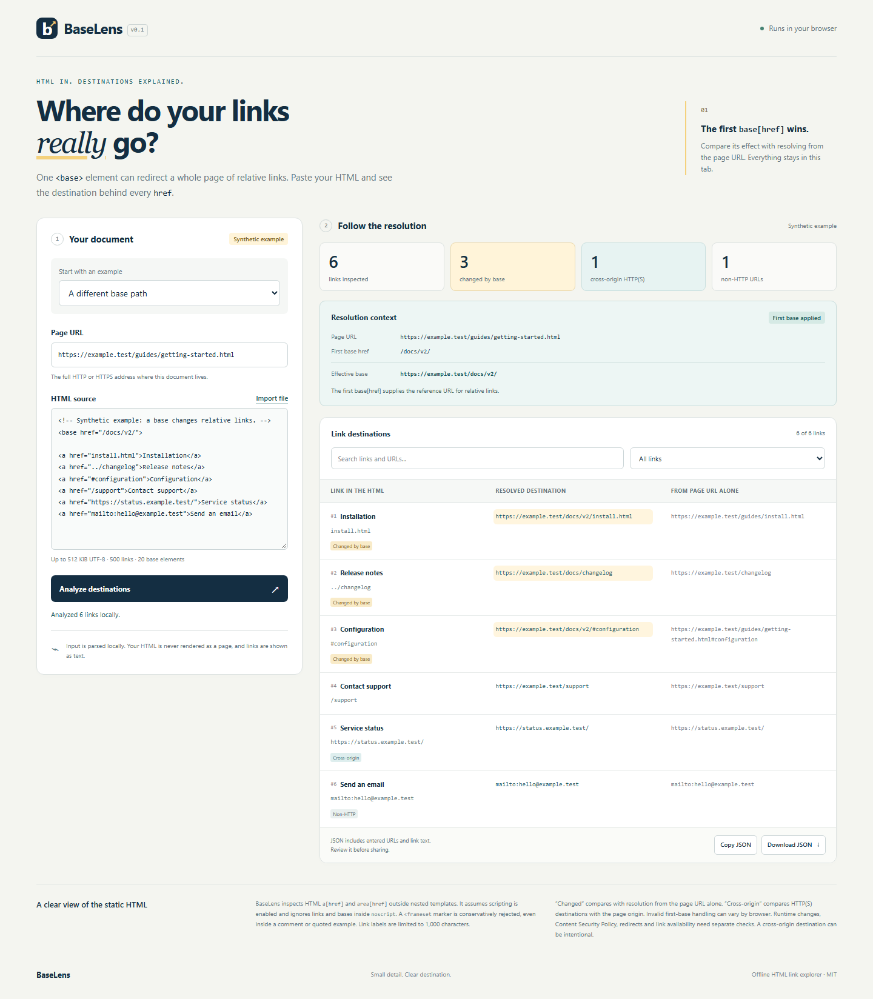

# BaseLens

**See exactly how `<base href>` changes your links.** Paste saved HTML and its page URL to compare each destination with and without the document's base element.

[Download the offline demo](https://github.com/4onv/baselens/releases/download/v0.1.0/baselens.html) · [Release and checksums](https://github.com/4onv/baselens/releases/tag/v0.1.0) · [Why this exists](docs/research-2026-11-05.md)

Save `baselens.html` and open it in a modern browser. It starts with a visibly labeled synthetic example. The complete app fits in that one file and runs locally.



For a page at `https://example.test/forum/topic.html` containing `<base href="/">` and `<a href="articles">`, BaseLens shows both destinations.

| Resolution | Destination |
| --- | --- |
| With the document base | `https://example.test/articles` |
| Against the page URL alone | `https://example.test/forum/articles` |

This helps explain scraper disagreements, moved documentation and fragment links that unexpectedly point at another document. A November 5 Scrapling report supplied the motivating example. [Upstream report](https://github.com/D4Vinci/Scrapling/issues/563)

## What you can do

- Paste HTML or load a local UTF-8 HTML file, then supply its original page URL.
- Inspect the first `base[href]`, its effective URL, ignored later bases and invalid-base fallback.
- Compare destinations, filter changed or cross-origin links, and search the results.
- Export the complete report as JSON or copy it for a debugging conversation. Exports include entered URLs and link text, so review them before sharing.
- Re-run against a different page URL to inspect relocation behavior.

The bundled examples are synthetic. Input stays in memory. Source markup is parsed in an inert template and its nodes stay detached. Result fields are displayed as text. The release embeds all application code and styles, with a restrictive Content Security Policy.

## Resolution contract

BaseLens extracts HTML `a[href]` and `area[href]` elements from an inert template. HTML entities are decoded by the browser. Links inside nested templates and foreign SVG/MathML elements are excluded. Area labels use `alt`; anchor labels use whitespace-normalized text.

The model follows first-base selection from the HTML specification. An empty href still counts. A malformed URL or a `data:`/`javascript:` base falls back to the supplied page URL, and later bases remain ignored. Other schemes use the host's WHATWG `URL` implementation. A relative link under an opaque base can consequently be invalid. [HTML standard](https://html.spec.whatwg.org/multipage/semantics.html#the-base-element)

Malformed first bases receive an explicit warning in the UI and exported report. Browser handling can diverge from the modeled fallback. During development, a Chromium comparison returned `about:blank` as the document base for an invalid host. Verify malformed-base cases in your target browser.

“Changed” compares the resolved URL with resolving the same href against the page URL alone. “Cross-origin” compares an HTTP(S) destination's scheme, hostname and effective port with the page's origin. An ordinary absolute external link can be cross-origin while remaining unchanged by the base.

The page URL must be absolute HTTP(S) and omit credentials. Bounds are 512 KiB of UTF-8 HTML, 500 links, 20 base elements and 8,192 UTF-16 code units per URL. Link labels are shortened to 1,000 code units and the report records the number shortened. Over-limit URLs or element counts stop analysis.

## Limits

This is static fragment analysis assuming scripting is enabled. Links and bases inside HTML `noscript` are excluded. A `<frameset` marker is conservatively rejected, including when it appears in a comment or quoted example. Runtime DOM edits, redirects, response headers, CSP `base-uri`, nested browsing-context fallback rules, XML `xml:base` and `target` navigation behavior require separate inspection. The supplied page URL should be the final response address. Malformed full-document HTML can parse differently in a template, especially table and document-structure recovery. Reachability, HTTP status and scraping-library behavior require separate network tests.

Chromium and Firefox exercise the downloadable artifact, including differential checks against actual browser DOM resolution for documented fixtures. Safari coverage is pending. Parsing and URL results follow the browser that opens the file.

## Use the engine

The zero-dependency URL engine also works in Node.js 22+ with already extracted attributes. Install the release archive directly if desired.

```sh
npm install https://github.com/4onv/baselens/releases/download/v0.1.0/4onv-baselens-0.1.0.tgz
```

```js
import { analyzeLinks } from '@4onv/baselens';

const report = analyzeLinks({
  pageUrl: 'https://example.test/forum/topic.html',
  bases: [{ href: '/' }],
  links: [{ tag: 'a', text: 'Articles', href: 'articles' }],
});
console.log(report.links[0].resolved); // https://example.test/articles
```

`@4onv/baselens/extract` exports `inspectHtml(html, pageUrl)` for browser environments. It requires a DOM and returns the same report with an `extraction` record. The core engine performs URL analysis on the attributes you provide.

## Develop and test

```sh
npm ci
npm run build
npm test
npx playwright install chromium firefox
npm run test:browser
```

Open `dist/baselens.html` after building. Development dependencies support browser testing. Runtime operation uses browser APIs and has zero package dependencies. The build is deterministic for identical source bytes. CI builds and tests on Linux and Windows, then exercises Chromium and Firefox on Linux.

## Alternatives and next steps

DevToolbelt already offers a full HTML link extractor with base-aware resolution, filters and exports. BaseLens focuses on explaining the difference caused by a base element in a downloadable local app. A Perl extraction library is another option for automated pipelines. [DevToolbelt](https://devtoolbelt.tech/tools/extract-links-from-html), [HTML::SimpleLinkExtor](https://github.com/nigelhorne/HTML-SimpleLinkExtor)

Useful next contributions include a licensed fixture demonstrating a real parser disagreement, Safari verification, or a small scraper integration using the exported report. Include the page URL, minimal HTML, expected destinations and browser version in a bug report. Share only information you intend to make public.

MIT licensed.
